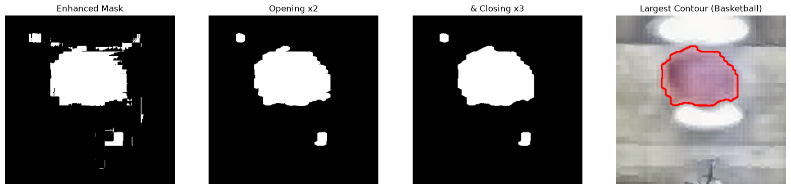
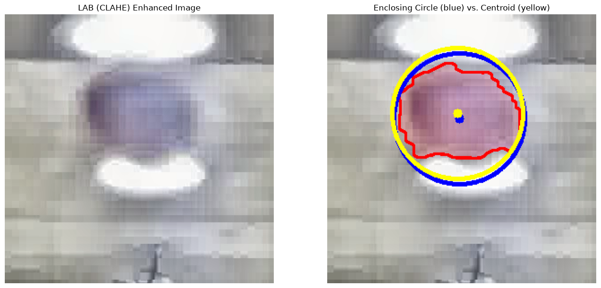

# Day03 과제 #2 — 모폴로지 연산으로 최종 농구공 Contour 선택

## 개요
`02_Computer-Vision.ipynb` H. Contour Detection의 미완성 TODO(셀 [188], [191]~[198])를 독립 실행 가능한 Python 파일로 옮겨 구현한 과제입니다.
CLAHE로 강화한 농구공 binary mask에 Opening·Closing을 적용해 노이즈를 지우고, 가장 큰 외곽선을 농구공으로 선택한 뒤 최소 외접원과 무게중심으로 공의 위치를 표시합니다.

| 파일 | 내용 | 원본 셀 |
|---|---|---|
| `todo01_ball_contour.py` | 모폴로지 연산 → 외곽선 검출 → 농구공 선택 → 외접원·무게중심 | [167], [188], [191], [194], [196], [198] |
| `results/` | 실행 결과 그림 (PNG) | |

## 실행 방법
```bash
source .venv/bin/activate
python 2026-10-17/todo01_ball_contour.py
```
어느 위치에서 실행해도 레포 기준 경로로 이미지를 읽고, 결과는 `2026-10-17/results/`에 저장됩니다. 화면에 창을 띄우지 않으므로 SSH 접속 중에도 실행할 수 있습니다.

## 구현 설명
1. **입력 mask (셀 [167]):** BGR → LAB 변환, L 채널에만 CLAHE(`clipLimit=3.0`, `tileGridSize=(8, 8)`) 적용, LAB 범위 `[70,130,70]~[180,230,185]`로 `inRange`.
2. **Morphological operation (셀 [188]):** 5×5 타원 커널로 **Opening 2회 → Closing 3회**.
   - Opening(침식 → 팽창)을 먼저 해서 공 위쪽의 흩어진 작은 노이즈를 지운다.
   - 그다음 Closing(팽창 → 침식)으로 공 내부의 빈 곳과 끊어진 경계를 메운다.
   - 순서를 바꾸면 노이즈가 먼저 팽창해 서로 붙어 버린다.
3. **외곽선 검출·선택 (셀 [188]):** `cv2.findContours(RETR_EXTERNAL, CHAIN_APPROX_SIMPLE)`로 바깥 외곽선만 찾고, `max(contours, key=cv2.contourArea)`로 **면적이 가장 큰 외곽선**을 농구공으로 선택. 노이즈는 상대적으로 면적이 작기 때문이다.
4. **최소 외접원 (셀 [191]):** `cv2.minEnclosingCircle`, 외곽선의 모든 점을 포함하는 가장 작은 원.
5. **무게중심 (셀 [194]):** `cv2.moments`로 `C_x = M10 / M00`, `C_y = M01 / M00`.
6. **무게중심 + 외접원 반지름 (셀 [196]), 비교 (셀 [198]):** 무게중심은 반지름을 주지 않으므로 외접원의 반지름을 빌려 원을 그린다.

### Opening·Closing 횟수 선택 근거
`results/00_iteration_comparison.png`에서 Opening 1~3회 × Closing 1~3회 9가지 조합을 비교했습니다.

| Opening | 남은 외곽선 수 | 관찰 |
|:---:|:---:|---|
| 1회 | 6개 | 공 위쪽의 작은 노이즈가 남음 |
| **2회** | **3개** | 작은 노이즈 제거, 공 모양 유지 |
| 3회 | 3개 | 더 지워지는 노이즈 없이 공 영역만 깎임 (면적 약 11,170 → 10,900px) |

- **Closing 횟수:** 결과 차이가 작아서, 공 경계의 오목한 부분을 가장 잘 메운 3회를 골랐습니다.
- **조합 비교 결과:** 어느 조합이든 가장 큰 외곽선은 농구공으로 선택되었습니다.

## 실행 결과
```
검출된 외곽선 3개 중 가장 큰 면적: 11170px
최소 외접원: 중심 (147, 116), 반지름 73px
무게중심: (145, 110)
```

| 그림 | 내용 |
|---|---|
|  | 강화 mask → Opening ×2 → Closing ×3 → 가장 큰 외곽선 |
|  | 최소 외접원(파랑) vs. 무게중심 기반 원(노랑) |

나머지 단계별 그림: `02_min_enclosing_circle.png`, `03_centroid.png`, `04_centroid_circle.png`

## 참고 사항
- **두 중심이 다른 이유:** 공 위·아래가 조명 반사로 하얗게 날아가 mask에서 빠졌기 때문에 외곽선이 원이 아니라 가로로 긴 모양입니다.
  - 그래서 외접원 중심 (147, 116)과 무게중심 (145, 110)이 약간 어긋납니다.
  - 외접원은 외곽선의 가장 바깥 점들에 맞춰지고, 무게중심은 픽셀 분포(위쪽에 더 많음)를 따라갑니다.
- **변수 이름:** 노트북 템플릿의 `M`, `cX`, `cY`는 PEP 8 이름 규칙(docs/GUIDE.md §5)에 맞춰 `moments`, `c_x`, `c_y`로 바꿨습니다.
- **함수로 분리:** 셀 [191]~[198]에 반복되던 "가장 큰 contour 영역·외곽선 그리기" 부분은 `draw_ball_region()` 함수 하나로 묶었습니다.
