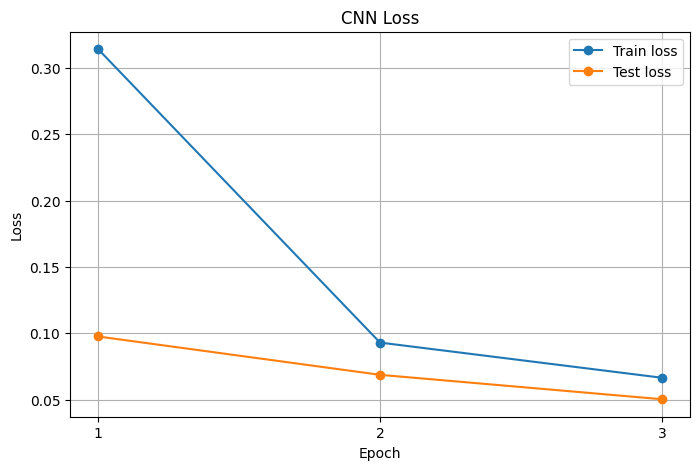
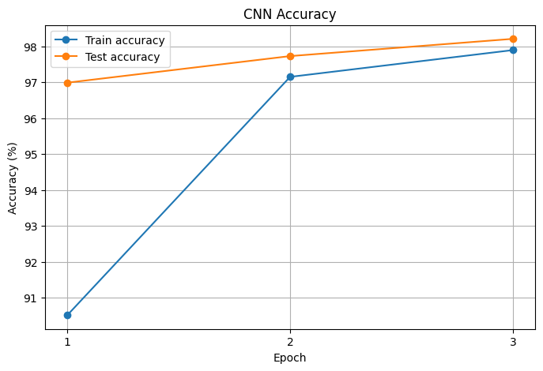
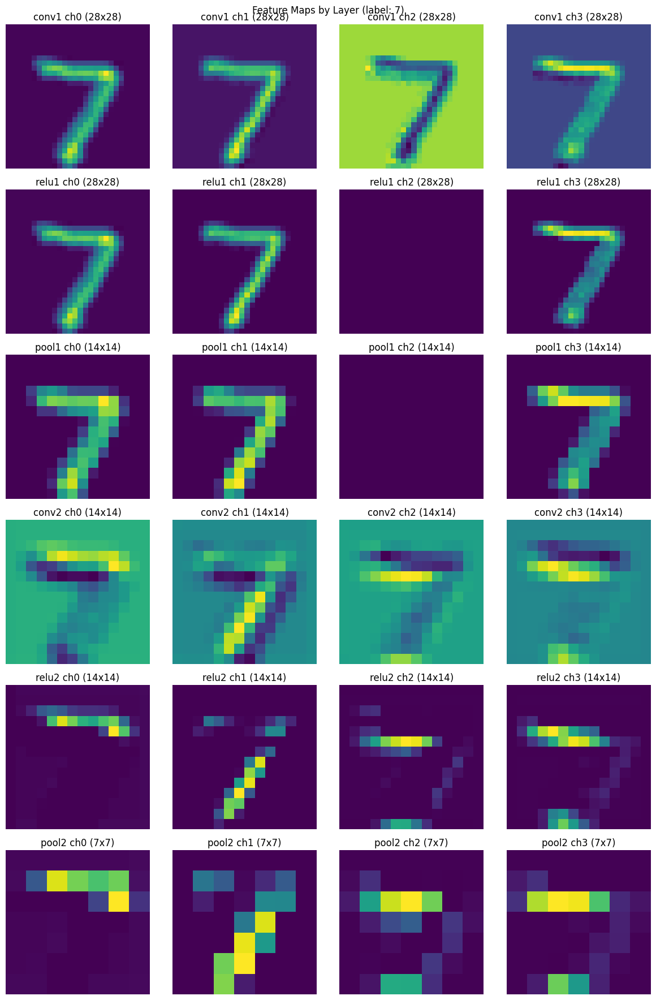
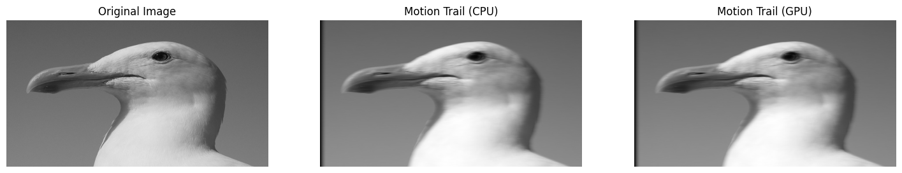
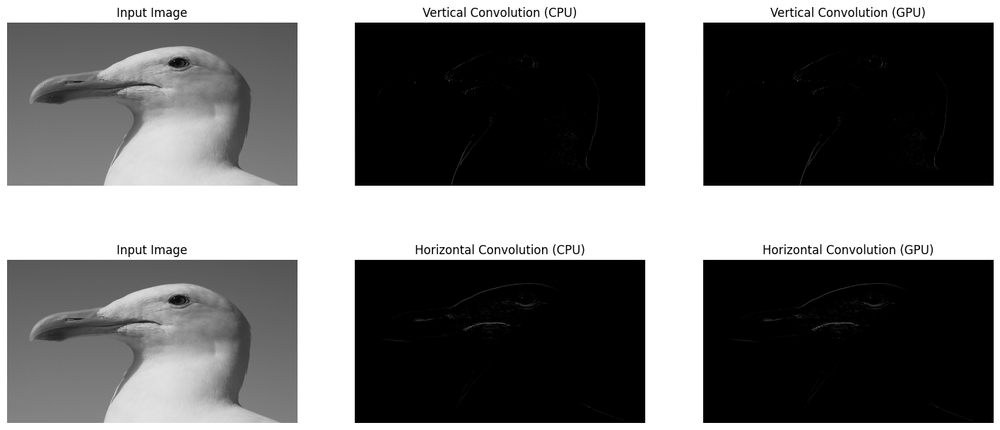

# Day06 과제 #3 — CNN 성능·Feature Map 확인, CuPy 잔상 효과·Convolution

## 개요
`03_DL-and-GPU.ipynb`의 미완성 TODO를 독립 실행 가능한 Python 파일로 옮겨 구현한 과제입니다.
- **F. CNN 실습 – MNIST:** 학습한 CNN의 Loss·Accuracy를 그래프로 그리고(16), 층별 Feature Map을 시각화합니다(17).
- **G. GPU 병렬 연산 (CuPy):** 이미지 잔상 효과(4)와 2차원 convolution(5)을 NumPy(CPU)와 CuPy(GPU)로 각각 구현하고 처리 시간을 비교합니다.

| 파일 | 내용 | 원본 셀 |
|---|---|---|
| `mnist_cnn.py` | todo01~03이 함께 쓰는 MNIST 데이터셋, `SimpleCNN`, 학습·평가 함수, `train_model()` | [145]~[237] |
| `todo01_loss_graph.py` | Epoch별 Train/Test Loss 그래프 | [243] |
| `todo02_accuracy_graph.py` | Epoch별 Train/Test Accuracy 그래프 (백분율) | [245] |
| `todo03_feature_maps.py` | Conv1 8개, Conv2 16개, 6개 층별 대표 Feature Map 4개씩 비교 | [196]~[198], [248] |
| `todo04_motion_trail.py` | 잔상 효과 NumPy/CuPy 함수, CPU↔GPU 복사, 처리 시간 비교 | [299]~[324] |
| `todo05_convolution.py` | CuPy 2차원 convolution 함수, 세로/가로 edge CPU·GPU 처리, 결과 비교 | [117]~[122], [330]~[338] |
| `results/` | 실행 결과 그림 (PNG) | |

## 실행 환경
- CUDA GPU 필요: `todo04`, `todo05`는 CuPy를 씁니다. `todo01~03`은 GPU가 없으면 CPU로 학습합니다.
- 의존성: `torch`, `torchvision`, `cupy`, `numpy`, `opencv-python`, `matplotlib`

## 실행 방법
```bash
source .venv/bin/activate
python 2026-10-25/todo01_loss_graph.py
python 2026-10-25/todo02_accuracy_graph.py
python 2026-10-25/todo03_feature_maps.py
python 2026-10-25/todo04_motion_trail.py
python 2026-10-25/todo05_convolution.py
```
- **경로:** 어느 위치에서 실행해도 레포 기준 경로로 이미지와 데이터셋을 읽습니다. 결과는 `2026-10-25/results/`에 저장됩니다.
- **데이터셋:** MNIST가 없으면 처음 실행할 때 `src/datasets/`에 내려받습니다.
- **화면 출력:** 창을 띄우지 않으므로 SSH 접속 중에도 실행할 수 있습니다.

## 구현 설명

### 공통: `mnist_cnn.py`
- **공통 모듈로 뺀 이유:** todo01~03은 모두 학습된 모델과 학습 기록이 필요합니다. 노트북 셀 [145]~[237]의 학습 코드를 파일마다 복사하는 대신 한 모듈에 모았습니다.
- **`train_model()`:** 셀 [237]의 Epoch 반복을 함수로 묶은 것입니다. 모델, 테스트 데이터셋, device, Epoch별 기록(dict)을 돌려줍니다.
- **device:** 노트북은 CPU로 고정했지만, 여기서는 `torch.cuda.is_available()`이면 GPU를 씁니다.
- **`show_feature_maps()`:** 셀 [194] 그대로에 `save_path` 인자만 추가해, 그림을 PNG로 저장합니다.

### F-16) 모델 성능 확인: `todo01`, `todo02`
- **x축:** `range(1, len(history) + 1)`로 Epoch 번호를 1부터 셉니다. `plt.xticks()`로 정수 눈금만 표시합니다.
- **Accuracy 단위:** `evaluate()`는 0~1 비율을 돌려주므로, 100을 곱해 y축 단위(%)에 맞췄습니다.

### F-17) 학습된 모델의 Feature Map 확인: `todo03`
1. **이미지 선택:** `test_dataset[0]`(정답 7)을 고르고, `unsqueeze(0)`으로 Batch 차원을 붙여 `[1, 1, 28, 28]`로 만듭니다.
2. **순전파:** `model.eval()`과 `torch.no_grad()` 안에서 `return_features=True`로 순전파합니다. 역전파 없이 층별 출력을 dict로 받습니다.
3. **Conv1·Conv2 시각화:** `show_feature_maps()`로 각 층의 채널 전체(8개, 16개)를 `cmap="viridis"`로 그립니다.
4. **6개 층 비교:** 행은 층 6개(`conv1` → `pool2`), 열은 채널 0~3입니다. 제목에 크기를 적어 28×28 → 14×14 → 7×7로 줄어드는 과정이 보이게 했습니다.

### G-4) CuPy 잔상 효과: `todo04`
- **NumPy (셀 [303]):** 출력 픽셀마다 `input_x = output_x - shift`로 왼쪽 픽셀을 찾아 가중치를 곱해 누적합니다.
  - `input_x < 0`이면 이미지 밖이므로 `break`합니다. 노트북 설명의 "밀린 자리는 0"과 같습니다.
- **CuPy (셀 [305]):** 같은 계산을 이동 거리 단위로 바꿨습니다.
  - `image[:, :width - shift]`와 `output[:, shift:]`는 크기가 같고, 원본을 오른쪽으로 `shift`칸 민 위치에 겹칩니다.
  - `output_region`은 `output`의 view라서, `+=` 하면 `output`에 바로 누적됩니다.
  - Python 반복은 `TRAIL_LENGTH`(32)번뿐이고, 한 번에 이미지 전체(1280×720)를 GPU가 병렬로 계산합니다.
- **CPU↔GPU 복사 (셀 [311], [317]):** 업로드는 `cp.asarray()`, 다운로드는 `cp.asnumpy()`입니다. matplotlib은 NumPy 배열만 그릴 수 있어서 결과를 다시 CPU로 가져옵니다.
- **시간 측정:** GPU 연산은 비동기라서 측정 전후에 `cp.cuda.Stream.null.synchronize()`로 연산이 끝나기를 기다립니다.

### G-5) CuPy Convolution: `todo05`
- **CPU (셀 [332]):** 셀 [117] `convolution2d()`를 그대로 옮겨 세로(`dx`)·가로(`dy`) edge 필터와 편향 -0.2(셀 [120], [122])를 적용합니다.
- **GPU 함수 (셀 [330]):** 잔상 효과의 slicing 누적을 2차원으로 넓혔습니다.
  - CPU 버전은 출력 픽셀(1280×720개)마다 3×3 영역을 잘라 가중합합니다.
  - GPU 버전은 반대로 커널 원소 `(kernel_y, kernel_x)` 9개만 반복합니다.
  - 반복마다 모든 출력 위치에서 그 원소와 곱해질 입력 픽셀을 slicing으로 한 번에 꺼내 `kernel[kernel_y, kernel_x]`를 곱해 출력 전체에 더합니다.
  - 출력 `(y, x)`에 대응하는 입력은 `(y * stride + kernel_y, x * stride + kernel_x)`이므로, slice 간격을 `stride`로 두어 stride가 1이 아니어도 같은 결과가 나옵니다.
  - padding(`cp.pad`)과 출력 크기 공식 `(H + 2P - K) // S + 1`은 CPU 버전과 같습니다.
- **GPU 처리 (셀 [334]):** 변환(`cp.asarray`) → 워밍업(64×64 이미지로 한 번 실행) → 처리(시간 측정) 순서입니다. ReLU는 GPU에서 `cp.maximum(0, x)`로 적용한 뒤 `cp.asnumpy`로 가져옵니다.
- **비교 (셀 [336]):** 처리 시간과 속도 향상, CPU·GPU 결과의 최대 차이를 출력합니다.

## 실행 결과

### F-16, F-17 (MNIST CNN, 3 Epoch)
```
Epoch 1/3 | Train loss: 0.3141 | Train accuracy: 90.49% | Test loss: 0.0976 | Test accuracy: 96.92%
Epoch 2/3 | Train loss: 0.0930 | Train accuracy: 97.13% | Test loss: 0.0687 | Test accuracy: 97.80%
Epoch 3/3 | Train loss: 0.0665 | Train accuracy: 97.93% | Test loss: 0.0503 | Test accuracy: 98.27%
True label: 7, Predicted label: 7
```

| Loss | Accuracy |
|---|---|
|  |  |

| 그림 | 내용 |
|---|---|
|  | 6개 층 × 채널 0~3 |

Conv1·Conv2 전체 채널: `03_conv1_feature_maps.png`, `03_conv2_feature_maps.png`

**관찰:**
- **Conv 출력:** `conv1`, `conv2` 출력에는 음수가 있습니다. `relu` 뒤에는 0 이상만 남습니다.
- **`relu1 ch2`:** 이 채널은 배경이 크고 획이 음수인 필터라서, ReLU를 거치면 거의 비게 됩니다.
- **Pooling:** 크기를 절반으로 줄이면서 강한 값만 남깁니다.
- **`conv2` 이후:** 가로 획, 대각선 획처럼 숫자의 부분 모양에 반응하는 채널이 나뉩니다.

### G-4 (잔상 효과, 1280×720, `TRAIL_LENGTH = 32`)
```
========== NumPy CPU ==========
Processing time: 10.6360 seconds

========== CuPy GPU ==========
CPU to GPU: 0.2386 seconds
GPU processing: 0.0034 seconds
GPU to CPU: 0.0016 seconds
Total GPU time: 0.2436 seconds

========== Comparison ==========
Compute-only speedup: 3138.15x
Including transfers: 43.67x
Max |CPU - GPU|: 0.00e+00
```



### G-5 (Convolution, 1280×720, 3×3 edge 필터 2개)
```
========== NumPy CPU ==========
Processing time (dx + dy): 12.1983 seconds

========== CuPy GPU ==========
CPU to GPU: 0.2399 seconds
GPU processing (dx + dy): 0.0028 seconds
ReLU + GPU to CPU: 0.1531 seconds
Total GPU time: 0.3958 seconds

========== Comparison ==========
Compute-only speedup: 4367.97x
Including transfers: 30.82x
Max |CPU - GPU| (vertical): 1.19e-07
Max |CPU - GPU| (horizontal): 2.38e-07
```



## 참고 사항
- **셀 [313] 워밍업 오류:** 노트북 원본은 `weights_np[:4]`(4개)를 넘깁니다.
  - `motion_trail_cp()`는 템플릿대로 `TRAIL_LENGTH`(32)번 반복하며 `weights[shift]`를 읽으므로, `shift = 4`에서 `IndexError: Index 4 is out of bounds`가 납니다.
  - 그래서 워밍업에는 가중치 전체(32개)를 넘깁니다. 함수 템플릿은 그대로 두었습니다.
- **결과 검증:** CPU와 GPU 결과의 최대 차이를 출력해 두 구현이 같은 값을 내는지 확인합니다.
- **업로드 시간:** 업로드(0.24초)가 GPU 계산(0.003초)보다 깁니다. 셀 순서상 업로드가 CuPy를 처음 쓰는 단계라서, GPU 초기화 시간이 업로드 시간에 함께 측정된 것으로 보입니다.
- **학습 반복:** todo01~03은 각각 독립 실행되도록 매번 모델을 새로 학습합니다. seed를 고정했지만 GPU 연산 특성상 Loss·Accuracy는 실행마다 소수점 둘째 자리 정도 달라질 수 있습니다.
- **잔상 가장자리:** 그림의 왼쪽 가장자리에 생기는 어두운 띠는 이미지 밖(0)을 더했기 때문입니다.
- **Convolution 결과 차이:** CPU와 GPU의 최대 차이는 약 1e-7로, float32에서 곱셈·덧셈 순서가 달라 생기는 반올림 오차 수준입니다. 작은 무작위 이미지로 stride 1~3, padding 0~2 조합에서도 두 함수의 출력 크기와 값이 같은지(오차 1e-6 이하) 확인했습니다.
- **ReLU + 다운로드 시간:** `cp.maximum`은 워밍업에서 쓰지 않은 연산이라, 처음 호출할 때의 준비 시간이 이 구간(0.15초)에 함께 측정된 것으로 보입니다.
