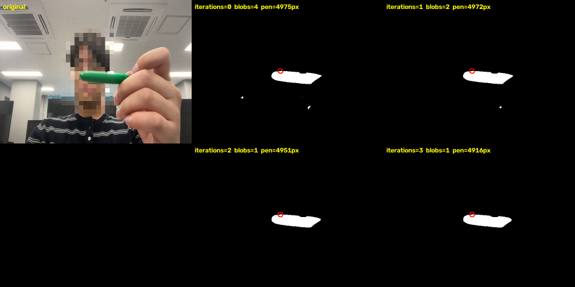
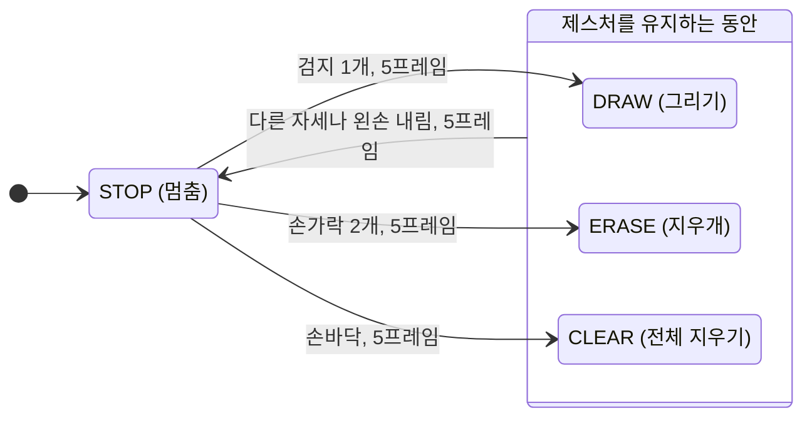

# Project01: 손가락 제스처 화이트보드

## 개요
오른손에 든 **초록 펜의 끝**을 Color Segmentation으로 검출하고 칼만 필터로 궤적을 부드럽게 보정해, 카메라 화면 위에 그림을 그리는 프로그램입니다.
**왼손의 펼친 손가락 개수**(엄지 제외)를 MediaPipe로 인식해 모드를 고릅니다. 신체(왼손 제스처)가 객체(펜)의 동작을 결정하는 구조입니다.

| 왼손 손가락 | 모드 | 동작 |
|:---:|---|---|
| 1개 | `DRAW` | 펜 끝을 따라 선을 그림 |
| 2개 | `ERASE` | 펜 끝이 지나간 자리를 지움 (지우개) |
| 손바닥 펴기 (엄지 제외 4개) | `CLEAR` | 캔버스 전체 지우기 |
| 그 밖의 자세, 왼손 내림 | `STOP` | 멈춤 (펜을 옮겨도 선이 생기지 않음) |

제스처를 **하고 있는 동안만** 그 모드로 동작합니다. 왼손을 내리면 멈춥니다.

| 파일 | 내용 | 원본 (`02_Computer-Vision.ipynb`) |
|---|---|---|
| `main.py` | 실행 진입점: 모드 판정, 캔버스 그리기, 화면 출력 | |
| `pen_tracker.py` | 초록 펜 끝 검출과 칼만 필터 보정 (단독 실행 시 펜 추적 테스트) | K. 실시간 객체 검출 [255] TODO, 모폴로지 반복 비교 [54] [55], L. Kalman Filter [266], USB 카메라 파이프라인 [245] |
| `hand_gesture.py` | 손 검출과 왼손 손가락 개수 세기 (단독 실행 시 제스처 테스트) | M. MediaPipe 손 검출 [275], 손가락 개수 [277] |
| `models/hand_landmarker.task` | MediaPipe 손 landmark 모델 (폴더만으로 실행되도록 포함) | 모델 다운로드 [273] |

## 실행 환경
- 기기: NVIDIA Jetson Orin / Python 3.10 (레포 루트 `.venv`, `--system-site-packages`)
- 카메라: USB 웹캠 `/dev/video0`, YUYV 640×480 30fps (GStreamer `v4l2src`)
- 의존성
  - `opencv` (`cv2`), `numpy`: JetPack 시스템 패키지
  - `mediapipe`: 수업 안내(노트북 셀 [271])대로 설치
    ```bash
    pip install --no-deps mediapipe
    pip install absl-py flatbuffers sounddevice
    ```
- 펜: 초록색 볼펜 1자루 (화면에 다른 초록 물체가 없어야 함)

## 실행 방법
```bash
source ../.venv/bin/activate   # Project01 폴더에서
python3 main.py
```
- `q`: 종료
- 창을 띄우므로 Jetson에 연결한 모니터에서 실행합니다.
- Mac처럼 GStreamer가 없는 환경에서는 `open_camera()`가 기본 카메라 0번을 640×480으로 엽니다. 이 경우 `pip install opencv-python mediapipe numpy`로 만든 별도 가상환경에서 실행합니다. Jetson에서는 이 명령을 쓰지 않습니다.
- 단계별로 확인하려면 `python3 pen_tracker.py`(펜 추적만) 또는 `python3 hand_gesture.py`(제스처만)를 실행합니다.

## 구현 설명

### 1. 펜 끝 검출 (`pen_tracker.find_pen_tip`)
수업 K장(셀 [255])의 TODO를 구현한 Day04 실습 `Green.py`의 초록 공 검출 흐름을 사용합니다. 셀 [255]는 초록 LAB 범위만 주고 전처리, 모폴로지, 특징 추출은 TODO로 비워 둡니다.
1. **전처리.** `GaussianBlur(7×7)`로 픽셀 노이즈를 줄인 뒤 BGR을 LAB로 변환합니다. LAB은 밝기(L)와 색(A, B)이 분리되어 조명 변화에 덜 민감합니다.
2. **Color Segmentation.** `inRange`로 초록 범위 `[30, 60, 90] ~ [230, 115, 180]` 안의 픽셀만 흰색으로 남긴 binary mask를 만듭니다.
3. **Morphology.** 5×5 타원 커널로 Opening을 한 번 해서 작은 노이즈를 지우고, Closing을 한 번 해서 펜 안쪽 구멍을 메웁니다. 둘 다 `iterations=2`라서 Opening은 깎기 2회 후 불리기 2회, Closing은 불리기 2회 후 깎기 2회입니다.
4. **Contour.** 면적 `MIN_AREA`(150px) 이하인 contour는 노이즈로 버리고, 가장 큰 contour를 펜으로 선택합니다.
5. **펜 끝.** 펜은 길쭉해서 무게중심이 펜 가운데에 생기고, 손으로 쥐면 가려집니다. 그래서 contour 점 중 y가 가장 작은 점(`argmin`), 즉 화면에서 가장 위쪽 점을 펜 끝으로 씁니다.

**Morphology 반복 횟수를 2로 둔 근거.** 노트북 모터 예제는 Opening의 `iterations`를 1~3으로 비교한 뒤(셀 [54]) 2회 결과에 Closing을 이어서 적용합니다(셀 [55]). 이 흐름을 따라 Opening 후 Closing, 각각 `iterations=2`로 정했습니다. 그리고 펜을 든 원본 프레임 35장으로 반복 횟수 0~4를 비교해 확인했습니다. 0~1회는 펜 말고 작은 잡티 덩어리가 남고, 2회에서 펜 한 덩어리만 남습니다. 3회 이상은 잡티는 더 줄지 않고 펜만 깎여서, 4회에서는 펜 끝 위치가 7px 밀립니다.



| iterations | 프레임당 덩어리 수 (펜 포함) | 펜 면적 (중앙값) | 펜 끝 위치 차이 (2회 대비) |
|---|---:|---:|---:|
| 0 (모폴로지 없음) | 5.0 | 2274 px | 1.0 px |
| 1 | 3.1 | 2274 px | 0.0 px |
| **2 (현재)** | **2.1** | **2145 px** | 기준 |
| 3 | 2.1 | 2032 px | 2.0 px |
| 4 | 1.5 | 1973 px | 7.1 px |

위 그림의 프레임은 펜을 옆으로 눕혀 든 장면이라, 빨간 원(가장 위쪽 점)이 펜 끝이 아니라 펜 윗면에 찍혀 있습니다. "알려진 한계"의 펜 방향 항목에 해당합니다.

### 2. 칼만 필터 보정 (`create_kalman`, `reset_kalman`, `smooth_tip`)
- 수업 L장의 `cv2.KalmanFilter(4, 2)` 설정을 그대로 사용합니다. 상태는 `[x, y, vx, vy]`, 측정은 `[x, y]`인 등속 모델입니다.
- 매 프레임 `predict()`로 위치를 예측하고, `correct()`에 검출 위치를 넣어 보정합니다. 그래서 검출 위치의 떨림이 줄어듭니다.
- **직접 구현 버전 대신 `cv2.KalmanFilter`를 쓴 이유.** 상태(`statePost`)를 객체가 들고 있어서, 함수로 나눠도 `mu_t`, `sigma_t`를 전역 변수로 주고받을 필요가 없습니다.
- **초기화.** 펜이 처음 보이거나, 한 프레임에 `MAX_JUMP`(80px)보다 멀리 튀면 그 위치에서 칼만을 다시 시작합니다.
  - `predict()`는 `statePost`에서 출발하므로 `statePre`와 `statePost`를 함께 설정합니다.
  - 초기화하지 않으면 보정 위치가 이전 위치에서 새 위치로 천천히 따라가면서, 실제로 지나가지 않은 구간에 선이 그려집니다.

### 3. 왼손 손가락 개수 (`hand_gesture.py`)
- **손 검출.** MediaPipe `HandLandmarker`(손 최대 2개)로 21개 landmark를 검출합니다.
- **왼손 라벨.** 화면을 좌우 반전(거울 모드)해서 넣으면 MediaPipe의 Left/Right가 실제 손과 반대로 나옵니다. 그래서 셀 [277]처럼 라벨을 뒤집어 실제 손 기준으로 맞춥니다.
- **손가락 개수.** 노트북은 양손 합계를 세지만, 여기서는 `GESTURE_HAND`(왼손) 한 손만 셉니다. 검지~소지마다 관절 세 점(예: 검지 5-6-7)이 이루는 각도를 계산해 160° 이상이면 펼친 것으로 봅니다.
- **엄지를 세지 않는 이유.** 엄지 1-2-3 각도를 측정하니, 엄지를 접고 검지만 편 자세에서 중앙값 160°, 손바닥을 편 자세에서 170°였습니다. 두 값이 임계값 160° 근처에 붙어 있어 접은 엄지와 편 엄지를 나눌 수 없습니다. 엄지를 세면 검지 1개가 2개로 읽혀 `DRAW`가 `ERASE`가 됩니다. 그래서 엄지를 빼고, 손바닥을 편 자세를 4개로 봅니다.

### 4. 모드 판정 (`main.update_mode`)
- 손가락 개수를 `MODES` 표(`{1: DRAW, 2: ERASE, 4: CLEAR}`)로 모드로 바꿉니다. 표에 없는 개수이거나 왼손이 안 보이면(`None`) `STOP`입니다.
- 손가락 개수는 프레임마다 흔들릴 수 있습니다. 그래서 같은 모드가 `GESTURE_HOLD_FRAMES`(5) 프레임 연속일 때만 모드를 바꿉니다. 왼손 검출이 4프레임 이하로 끊기면 모드가 바뀌지 않으므로 그리던 선도 끊기지 않습니다.

모드는 아래처럼 바뀝니다. `DRAW`, `ERASE`, `CLEAR` 사이도 그 자세를 5프레임 유지하면 `STOP`을 거치지 않고 바로 바뀝니다.



### 5. 캔버스 (`main.py`)
- 프레임과 같은 크기의 검은 캔버스(`np.zeros_like`)를 만듭니다.
- `DRAW`와 `ERASE`는 둘 다 직전 점과 현재 점을 `cv2.line`으로 잇습니다. `STROKES` 표에서 색과 두께만 다릅니다.
  - `DRAW`: 자홍색, 두께 5
  - `ERASE`: 검은색, 두께 40. 캔버스에서 검은색은 "그림 없음"이라 그 자리가 지워집니다. 점이 아니라 선으로 지워서, 펜을 빠르게 움직여도 지운 자리 사이에 틈이 생기지 않습니다.
- `CLEAR`인 동안은 매 프레임 캔버스 전체를 0으로 채웁니다.
- `STOP`이거나 펜이 안 보이면 `prev_point = None`으로 선을 끊습니다.
- **출력.** 캔버스에서 그림이 있는 픽셀(`canvas.any(axis=2)`)만 프레임 위에 덮어씁니다.
  - 펜 검출과 손 검출은 그림을 덮기 전의 원본 프레임에서 합니다. 그래서 화면에 그린 선이 검출에 영향을 주지 않습니다.

## 참고 사항
- **처음 실행할 때 확인할 것**
  1. `python3 hand_gesture.py`를 실행하고 **왼손만** 들었을 때 화면에 `Left`가 나와야 합니다. `Right`가 나오면 `hand_gesture.py`의 `GESTURE_HAND`를 `"Right"`로 바꿉니다.
  2. `python3 pen_tracker.py`를 실행해 "Pen Mask" 창에서 펜이 흰색으로 잡히는지 봅니다. 배경이 같이 잡히면 `GREEN_LOWER`, `GREEN_UPPER` 범위를 좁히거나 `MIN_AREA`를 올립니다.
- **알려진 한계**
  - **엄지 미사용.** 엄지는 세지 않으므로 엄지만 펴거나 엄지와 검지를 함께 펴도 1개로 읽힙니다.
  - **다른 초록 물체.** 펜 말고 150px(`MIN_AREA`)보다 큰 초록 물체가 화면에 있으면, 그 물체가 펜보다 크거나 펜이 가려졌을 때 그 물체를 펜으로 잡습니다.
  - **펜 방향.** 펜 끝은 가장 위쪽 점으로 정하므로, 펜을 눕히거나 거꾸로 들면 펜 끝 위치가 틀립니다.
  - **칼만 지연.** 칼만 보정 때문에 펜을 빠르게 움직이면 선이 조금 늦게 따라옵니다. `pen_tracker.py`의 `measurementNoiseCov`를 줄이면 반응이 빨라지는 대신 떨림이 늘어납니다.
